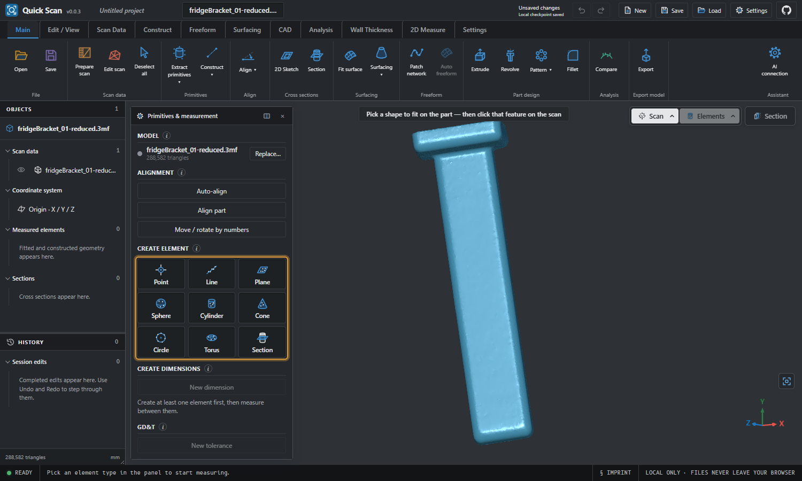

<p align="center">
  
</p>

<h1 align="center">Quick Scan</h1>

<p align="center">
  A Windows desktop app for turning 3D scans into measured, editable CAD.<br />
  Built on <a href="https://github.com/CNCKitchen/ScanRuler">ScanRuler</a> by CNC Kitchen. Open source, AGPL-3.0.
</p>

<p align="center">
  <a href="https://github.com/stuartraymor/quick-scan/releases/latest"><b>Download for Windows</b></a>
  &nbsp;·&nbsp;
  <a href="CHANGELOG.md">Changelog</a>
  &nbsp;·&nbsp;
  <a href="docs/manual.md">Manual</a>
</p>

> **Early release (0.0.x).** Quick Scan is young software. It is useful for
> real work on the features listed below, and honest about what is missing in
> [Known limitations](#known-limitations). It is **not** a drop-in replacement
> for any commercial reverse-engineering package.



## What it is

Quick Scan opens a 3D scan (STL, OBJ, PLY, 3MF), lets you align it, fit
geometric primitives to it, measure between them, compare it with a CAD
reference and then build a clean parametric model on top of it. Everything
runs on your own computer. Your files are not uploaded anywhere unless you
deliberately connect an AI agent.

The window is laid out as a ribbon of command tabs (Main, Edit / View, Scan
Data, Construct, Freeform, Surfacing, CAD, Analysis, Wall Thickness, 2D
Measure) over an Objects / History explorer, a movable tool panel and a 3D
viewport. Tool panels are modeless: you can move, dock, hide and bring them
back without losing the operation in progress. The layout and navigation
(middle-mouse orbit, Ctrl+middle pan, Shift+middle zoom) were chosen to feel
familiar if you have used other scan-to-CAD software.

## Features

- **Import and export** scans and meshes, save and reopen `.scanruler`
  project files, export bodies as STEP.
- **Primitive fitting.** Click a feature and get a best-fit plane, cylinder,
  cone, sphere, torus or circle with its form error. Construct points, lines
  and planes from the fits.
- **Alignment.** Auto-align from the scan's own faces, guided datum alignment,
  symmetry-plane alignment and move/rotate by numbers.
- **Measurement.** Distance and angle dimensions with tolerances, GD&T checks,
  wall thickness maps and deviation colour plots against a CAD reference.
- **Sections.** Cut a section through any element and measure it on the 2D
  sheet.
- **CAD modelling.** Sketch, extrude, revolve, fillet, chamfer, move face,
  combine, pattern, mirror, split, loft, sweep, thicken, offset, patch-network
  and fit-surface tools, with a feature history, on an exact OpenCASCADE
  kernel.
- **Mesh tools.** Clean up and reduce meshes.
- **AI command interface.** Optional agent bridge (MCP) so an assistant can
  drive the same session you see on screen.

Most of the measurement and mesh engine is inherited from ScanRuler. See its
[manual](docs/manual.md) for how each measurement is computed.

## Install

1. Download `Quick-Scan-Setup-<version>.exe` from the
   [latest release](https://github.com/stuartraymor/quick-scan/releases/latest).
2. Check the SHA-256 shown in the release notes against the file
   (`Get-FileHash .\Quick-Scan-Setup-<version>.exe`).
3. Run it and follow the wizard. No administrator rights are needed for the
   default per-user install.

**Windows SmartScreen.** Release installers are not code-signed yet, because
signing needs a paid certificate. Windows may show "Windows protected your PC".
That warning means "unrecognised publisher", not "malware found". Choose
*More info → Run anyway* only if you trust the download and its checksum
matched. Build it yourself from this repository if you would rather not.

Requirements: Windows 10 or 11, 64-bit, a GPU able to run WebGL 2.

## Build from source

Requires Node.js 22 or newer.

```bash
npm install
npm run dev        # local dev server
npm test           # unit tests
npm run build      # type-check and production build into dist/
```

Package the desktop app and installer (Windows, needs
[Inno Setup 6](https://jrsoftware.org/isinfo.php)):

```bash
node package-desktop.mjs                     # packaged app in desktop-build/
installer/build-installer.ps1 -AppDir "desktop-build/Quick Scan-win32-x64"
```

See [installer/README.md](installer/README.md) for code signing. More on tests
and releases: [docs/development.md](docs/development.md).

## Known limitations

Plain statements, so you do not discover them the hard way:

- **Not a QUICKSURFACE clone and not affiliated with it.** Quick Scan is an
  independent implementation whose command placement and terminology take
  inspiration from familiar scan-to-CAD workflows. It does not contain code or
  assets from any commercial product. Version 0.0.39 verifies selected Objects,
  History and navigation workflows against observed reference behavior; full
  feature, algorithm and graphical parity has not been achieved or certified.
- **Partial model history is read-only.** Back/Forward and dragging the End of
  Model marker change the active core/CAD model. Restore End of Model before
  creating, editing or importing CAD. Editing a rolled-back branch is not
  supported. Older projects lack a shared cross-workspace creation order; their
  recovered order is approximate.
- Context menus remain incomplete; the verified Edit, visibility and existing
  CAD sketch deletion workflows do not certify every reference menu command.
- True quad / SubD freeform and automatic surfacing is **not implemented**.
  The patch-network and fit-surface tools are different capabilities.
- Stacked sections are not implemented. Tertiary alignment is point-based, not
  primitive-based.
- Windows 64-bit only. Quick Scan is packaged as an Electron app; there are no
  macOS or Linux builds.
- Test coverage is focused (unit tests, scripted browser checks, a packaged-app
  smoke test and installed Windows acceptance), not exhaustive. See
  [0.0.39 verification](RELEASE-VERIFICATION.md) for the tested scope and counts.
- Version 0.0.x file and profile formats may change. Keep your source scans.
- Installers are unsigned (see above).

## Roadmap

Planned work is tracked in the
[issues](https://github.com/stuartraymor/quick-scan/issues). The honest short list: stacked sections, primitive-based datum alignment,
independent quad/SubD surfacing, and more review of command sequences against
observed workflows.

## Attribution and license

Quick Scan is a modified version of
[**ScanRuler** by Stefan Hermann (CNC Kitchen)](https://github.com/CNCKitchen/ScanRuler),
used under the **GNU Affero General Public License v3.0 only**. See
[LICENSE](LICENSE) and [ATTRIBUTION.md](ATTRIBUTION.md). The complete
corresponding source of every release is this repository.

- The ScanRuler and CNC Kitchen names and logos are trademarks of their owner
  and are not covered by the code license. This project is **not endorsed by
  or affiliated with CNC Kitchen**. Do not contact them for Quick Scan support.
- ScanRuler's dual-licensing materials ([COMMERCIAL.md](COMMERCIAL.md),
  [CLA.md](CLA.md)) are retained unchanged for provenance. They describe the
  upstream author's arrangements and do not apply to this fork's maintainers.
- Third-party components keep their own licenses: Open CASCADE Technology
  (LGPL-2.1 with exception, loaded as a separate WebAssembly file), Three.js,
  React and others (permissive), bundled fonts (SIL OFL 1.1), viridisLite
  colour maps (MIT). See [CONTRIBUTING.md](CONTRIBUTING.md) for the dependency
  policy.

## Contributing

Reviewing Quick Scan against QUICKSURFACE? Start with [docs/REVIEWER_HANDOVER.md](docs/REVIEWER_HANDOVER.md).

Issues and pull requests are welcome. Read [CONTRIBUTING.md](CONTRIBUTING.md)
and the [Code of Conduct](CODE_OF_CONDUCT.md). Report security problems
privately as described in [SECURITY.md](SECURITY.md).
